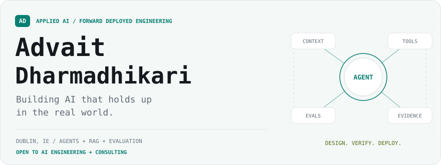
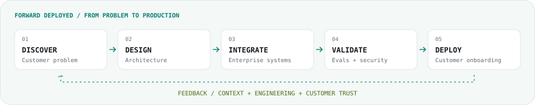
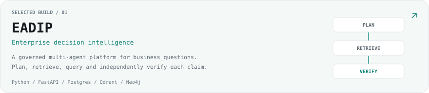
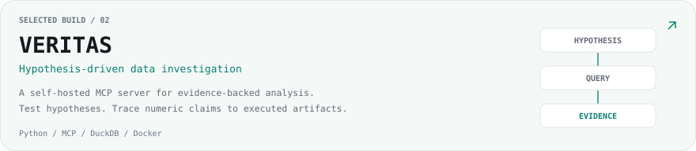
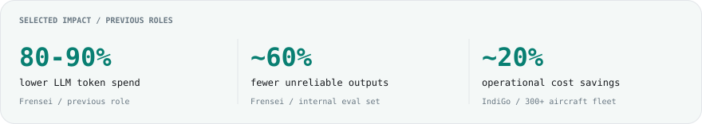
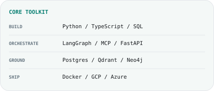

<picture>
  <source media="(prefers-color-scheme: dark)" srcset="svg/hero-dark.svg">
  
</picture>

  <samp>
    <a href="https://www.linkedin.com/in/advaitdharmadhikari">LinkedIn</a> ·
    <a href="https://advaitdharmadhikari.netlify.app">Portfolio</a> ·
    <a href="https://medium.com/@advaitdharmadhikari7">Writing</a> ·
    <a href="mailto:advaitdharmadhikari27@gmail.com">Email</a>
  </samp>

# From business questions to production AI

I'm **Advait**, a **Forward Deployed Engineer working in Applied AI**, based in
**Dublin, Ireland**. I partner with customers, product teams and engineering
organizations to turn ambiguous business challenges into production AI systems.

My work connects **agentic systems, RAG and LLM evaluation** with the practical
work of enterprise deployment: architecture, integrations, AI security,
customer discovery and adoption. I've applied that approach to financial-services
compliance intelligence and airline operations across a **300+ aircraft fleet**.

My path into engineering started in business analytics and operations. That
perspective still shapes how I build: start with the decision, understand the
constraints, and deliver software people trust enough to use.

> **Open to opportunities:** Founding AI Engineer, Applied AI Engineer,
> Forward Deployed Engineer and AI consulting — in Ireland, across Europe
> and globally.

<samp>
<a href="#how-i-deliver-enterprise-ai">Approach</a> /
<a href="#selected-work">Selected work</a> /
<a href="#research">Research</a> /
<a href="#engineering-toolkit">Toolkit</a> /
<a href="#experience">Experience</a> /
<a href="#github-activity">Activity</a>
</samp>

## How I deliver enterprise AI

<picture>
  <source media="(prefers-color-scheme: dark)" srcset="svg/delivery-dark.svg">
  
</picture>

- **Discover with the customer.** Lead technical discovery, requirements
  definition and stakeholder alignment; connect the architecture to the
  operational decision it needs to improve.
- **Build for enterprise constraints.** Integrate Gmail and Microsoft Graph
  through OAuth 2.0, with incremental synchronization, secure consent flows,
  tenant isolation, PII masking and audit trails.
- **Validate and support adoption.** Use structured-output checks, confidence
  thresholds and regression tests, while working with leadership on roadmap,
  pricing, onboarding and customer deployments.

My independent work includes **EADIP**, **Veritas**, open-source Python
packages and research into the reliability and oversight of agentic AI.

## Selected work

<a href="https://github.com/advait27/EADIP">
<picture>
  <source media="(prefers-color-scheme: dark)" srcset="svg/eadip-dark.svg">
  
</picture>
</a>

**[EADIP — Enterprise Autonomous Decision Intelligence Platform](https://github.com/advait27/EADIP)**
 A governed system that investigates business questions end to end:
plan, retrieve, query, verify and report. An independent Verification Agent
re-derives numeric claims before they enter a report. Human approval gates
side-effecting actions, Postgres row-level security isolates tenants, and
GraphRAG grounds metric-lineage questions. Built across 12 delivery phases
with 274 unit and integration tests.

<a href="https://github.com/advait27/Veritas">
<picture>
  <source media="(prefers-color-scheme: dark)" srcset="svg/veritas-dark.svg">
  
</picture>
</a>

**[Veritas — hypothesis-driven investigation over MCP](https://github.com/advait27/Veritas)**
 A self-hosted MCP server that builds and tests hypothesis trees over CSV,
Parquet and Excel data using DuckDB. Numeric claims trace to executed
artifacts; opportunity and risk discovery uses false-discovery-rate control
and a public evaluation suite of planted-cause datasets.

<b>Six published Python packages + more projects</b>

| Package | Purpose |
|:--|:--|
| [hallucimap](https://pypi.org/project/hallucimap/) | Hallucination-risk scoring and segment-level triage for LLM outputs |
| [fraudguard](https://pypi.org/project/fraudguard/) | Fraud and anomaly classification for financial transactions |
| [finfeatures](https://pypi.org/project/finfeatures/) | Financial and time-series feature engineering |
| [finance-automl](https://pypi.org/project/finance-automl/) | Financial time-series AutoML with leakage prevention |
| [esgprofiler](https://pypi.org/project/esgprofiler/) | ESG scoring and profiling with NLP |
| [mlopter](https://pypi.org/project/mlopter/) | ML-enhanced optimization with pluggable solvers |

More builds: [ChartSense](https://github.com/advait27/chartsense) ·
[Jarvis](https://github.com/advait27/jarvis) ·
[AI Cost & Growth Optimizer](https://github.com/advait27/ai-cost-growth-optimizer) ·
[Market Pulse AI](https://github.com/advait27/market-pulse-AI).

## Impact from previous roles

<picture>
  <source media="(prefers-color-scheme: dark)" srcset="svg/impact-dark.svg">
  
</picture>

These outcomes come from earlier work, including my **former role at Frensei
Innovation Labs**. The output-reliability reduction was measured on an internal
evaluation set of labelled broker threads.

| Outcome | Previous work |
|:--|:--|
| **80–90% lower LLM token spend per broker** | Targeted-surveillance architecture at Frensei: header scan → PII-masked body fetch → LLM classification |
| **~60% fewer hallucinated or inconsistent outputs** | Production evaluation, structured-output checks and calibrated confidence thresholds at Frensei |
| **~20% operational cost savings** | Aircraft weight prediction and operational cost models at IndiGo |
| **~40% decision-quality improvement** | BI reporting logic and insight frameworks on GCP / Azure at IndiGo |
| **25% new-business growth** | A 15-member analyst team at CHRIST Consulting |

## Research

**Forward Deployed Engineering: A Systems Engineering Perspective**
 <samp>First-author preprint / 2026</samp>
 Studies forward deployed engineering as a systems-engineering discipline
through a multivocal literature review, mapping it to ISO/IEC/IEEE 15288
lifecycle processes and proposing a cross-organizational enterprise-AI
deployment lifecycle.

**What Agent Traces Cannot Tell You: Evidentiary Adequacy of Runtime Records for Agentic AI Oversight**
 <samp>First-author preprint + open benchmark / 2026</samp>
 Tests whether runtime records support the findings of fact required for AI
oversight. Across 1,200 enterprise agent trajectories, six determination
families and four record conditions, coverage rises from **16.3%** for action
logs and OpenTelemetry GenAI spans to **100%** for a labelled substrate.

Ongoing research: **context engineering, enterprise agents, AI evaluation
and observability**.

## Engineering toolkit

| Layer | Tools and practices |
|:--|:--|
| Languages & APIs | Python · TypeScript · SQL · FastAPI · MCP |
| Agents & retrieval | LangGraph · multi-agent orchestration · RAG · semantic search · tool calling · context and graph engineering |
| Data & storage | PostgreSQL · DuckDB · Supabase · Redis · Qdrant · Neo4j |
| Reliability | Evaluation harnesses · structured outputs · confidence scoring · OpenTelemetry · pytest · mypy · ruff |
| Deployment | Docker · GCP · Azure · CI · multi-tenant SaaS · hybrid and VPC deployment |
| Enterprise integration & security | Gmail API · Microsoft Graph · OAuth 2.0 · incremental sync · PII masking · prompt-injection defense · row-level security · AES-256-GCM · audit logging |
| Customer delivery | Technical discovery · requirements definition · stakeholder alignment · solution design · customer onboarding · product roadmap and pricing strategy |

## Experience

**Founding AI Engineer & Product Lead — Frensei Innovation Labs / ClawbackVault AI**
 <samp>Nov 2025 – Sep 2026 · Previous role · Dublin, Ireland</samp>
 Partnered with leadership and customers to design and deploy a compliance-
intelligence platform for financial services under enterprise security,
privacy and regulatory constraints.

- Architected targeted email intelligence that reduced LLM inference costs
  **80–90%**, and behavioural risk detection across **15+ categories** with
  structured evidence, confidence scoring and explainable outputs.
- Built Gmail API and Microsoft Graph integrations with OAuth 2.0,
  incremental synchronization, tenant isolation and secure consent flows.
  Implemented PII masking before model calls, AES-256-GCM encryption,
  prompt-injection protection, GDPR exports and audit logging; helped the
  platform satisfy CASA Tier 2 and Google OAuth Restricted Scope requirements.
- Built production evaluation workflows and partnered with the Founder on
  technical discovery, customer onboarding, roadmap and pricing strategy.

**Business Analyst & ML Engineer — IndiGo / InterGlobe Aviation**
 <samp>Jan 2024 – Aug 2025 · Gurugram, India</samp>
 Delivered ML and decision intelligence for operations across a **300+
aircraft fleet**. Developed aircraft weight prediction and operational cost
models, contributing to **~20% cost savings**. Led technical discovery,
requirements definition and stakeholder alignment, and built cloud analytics
for operations, maintenance and executive decision-making.

**Business Intelligence Engineer, Business Technology & Product — IndiGo**
 <samp>Jun 2023 – Dec 2023 · Gurugram, India</samp>
 Built production BI and insight frameworks on **GCP and Azure**. Led
requirements gathering, problem analysis and solution design; new reporting
logic and product parameters improved decision quality by **~40%**.

**Teaching Assistant, Digital Technologies in Business — University College Dublin**
 <samp>Jan – May 2026</samp>
 Taught postgraduate tutorials on AI in business, digital transformation
and data-driven decision-making for 150+ students. Guided case studies in
technology adoption, AI strategy and business value creation, collaborating
with faculty to connect course content to production practice.

<b>Earlier experience & mentoring</b>

**Business Development Analyst, Team Lead — CHRIST Consulting**
 <samp>Jun 2021 – Jun 2022 · India</samp>
 Led a **15-member analyst team** on market-entry and growth strategy,
translating analysis into executive presentations and client recommendations.
Drove **25% growth in new-business acquisition** and approximately **15%
improvement in renewals and upsells**.

**Business Analytics & ML Mentor — topmate.io**
 <samp>Jan 2025 – May 2026</samp>
 Coached professionals on LLM application development and moving into
AI engineering roles.

Earlier internships in data science and analytics: IndiGo, LetsGrowMore,
The Sparks Foundation and EntryLevel (2020–2023).

## Education

- **MSc, Business Analytics** — UCD Michael Smurfit Graduate Business School *(Sep 2025 – Sep 2026)*
- **PG Professional Certification, AI & Machine Learning** — IIT Kanpur *(Oct 2023 – Jul 2024)*
- **BBA, Business Analytics & Data Science** — Christ University, Bangalore *(Jun 2020 – Jun 2023)*

Honours: **Global Leadership Programme**, awarded by the Dean of the UCD
College of Business, and the **UCD Advantage Award** (2026).

<b>Certifications & additional learning</b>

- Introduction to Model Context Protocol
- Data Strategy
- Google Project Management Professional
- BCG Advanced Analytics and Data Science Virtual Experience
- Data visualization and analytics experience program

## GitHub activity

<picture>
  <source media="(prefers-color-scheme: dark)" srcset="svg/pulse-dark.svg">
  
</picture>

<picture>
  <source media="(prefers-color-scheme: dark)" srcset="svg/streak-dark.svg">
  
</picture>
<picture>
  <source media="(prefers-color-scheme: dark)" srcset="svg/skills-dark.svg">
  
</picture>

<picture>
  <source media="(prefers-color-scheme: dark)" srcset="svg/year-dark.svg">
  
</picture>

<picture>
  <source media="(prefers-color-scheme: dark)" srcset="svg/now-dark.svg">
  
</picture>

Activity data, language breakdown and repository links as text

<!-- data:start -->

| | |
|:--|--:|
| Contributions (365 days) | 1,442 |
| Commits / pull requests / reviews | 193 / 10 / 0 |
| Current streak | 1 days |
| Longest streak | 10 days |
| All-time contributions | 1,575 |
| Active days since 2020 | 165 |
| Public repositories | 38 |

**Languages, measured — by primary language of repository**

| | |
|:--|--:|
| Python | 47% (18) |
| Jupyter Notebook | 37% (14) |
| HTML | 13% (5) |
| JavaScript | 3% (1) |

Ranked by bytes instead, this reads as 74% Jupyter Notebook — notebooks store rendered cell outputs as base64 in their own JSON, and Linguist counts those plots as authored code.

**Most recently pushed**

| | | |
|:--|:--|--:|
| [EADIP](https://github.com/advait27/EADIP) | HTML | 2026-09-27 |
| [Advait-portfolio](https://github.com/advait27/Advait-portfolio) | HTML | 2026-09-17 |
| [AI-Research](https://github.com/advait27/AI-Research) | Python | 2026-09-17 |
| [Krypton](https://github.com/advait27/Krypton) | Python | 2026-09-14 |
| [AtlasAI](https://github.com/advait27/AtlasAI) | Python | 2026-08-30 |

Generated 2026-10-21 from `data/snapshot.json`.

<!-- data:end -->

Activity figures are measured from the GitHub API. The toolkit describes
technologies I use; it is not a proficiency score. Career outcomes above are
from previous roles and are separate from GitHub activity.

## Writing & speaking

I write about applied AI, RAG, agentic architecture, evaluation and turning
AI into adopted products on [Medium](https://medium.com/@advaitdharmadhikari7).

Podcasts: [The Business Technologist](https://open.spotify.com/show/2nMlpUNSqh9ZiI1vsg5B1g) ·
[5 Minute Boosters](https://open.spotify.com/show/32D27hJiy5sEZ7RnULzcBS).

## Let's build something useful

Working on agents, evaluation, decision intelligence or enterprise AI?
[Get in touch](mailto:advaitdharmadhikari27@gmail.com) or
[connect on LinkedIn](https://www.linkedin.com/in/advaitdharmadhikari).

How this profile builds itself

Custom SVGs, generated in light and dark themes with embedded JetBrains Mono.
The graphics are served from this repository.

A nightly [workflow](.github/workflows/refresh.yml) fetches GitHub data into
[`data/snapshot.json`](data/snapshot.json).
[`scripts/render.py`](scripts/render.py) renders every panel offline and updates
the text fallback. Committed font subsets keep repeated renders deterministic;
[`scripts/verify.py`](scripts/verify.py) checks assets, accessibility metadata,
size limits, output stability and GitHub's Markdown sanitiser.

Implementation notes: [`docs/how-it-works.md`](docs/how-it-works.md).

---

Dublin, Ireland · English, Hindi, Marathi ·
<a href="mailto:advaitdharmadhikari27@gmail.com">advaitdharmadhikari27@gmail.com</a>
